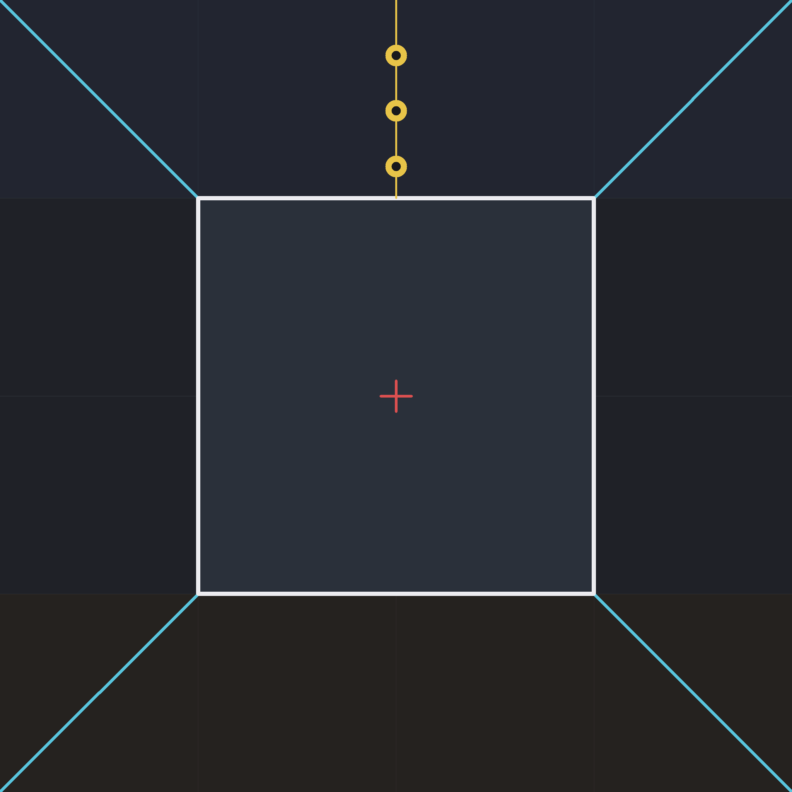

# interior-mapping-webgpu

[English](README.md) · [中文](README.zh-CN.md)

three.js `0.187` WebGPU scene: a three-storey house with a courtyard (`studio_3f_im.glb`), 2D Interior Mapping on the south and north windows. Day and night lighting; at night, street lamps, a door canopy light, and window lights. Post: bloom, color grading, ACES, dithering. The building model, facade textures, and 2D interior maps are AI-generated.

Live demo: https://interior-mapping-webgpu.vercel.app/  
Needs a WebGPU browser (Chrome, Edge, or a recent Safari).

## Run

```bash
pnpm install
pnpm dev
```

Open http://localhost:5173/

## Controls

Drag and scroll to orbit. Three icons, bottom right, left to right:

- Sun / moon: day and night
- Window pane: toggle interior mapping
- Bulb: window lights at night (disabled in daytime). Street lamps and the canopy light follow day/night only, not this button

## Interior maps

Map spec (Chinese): [`public/docs/im-2d.md`](public/docs/im-2d.md). Finished maps must match this template: white frame = far wall, cyan lines = corners, red cross = vanishing point.



Files live in `public/textures/im/L{0-2}/`, named `{day|night}-{N|S}-L{0-2}-{W|C|E}.png`. The south ground-floor center is a door, so there is no `S-L0-C`.
