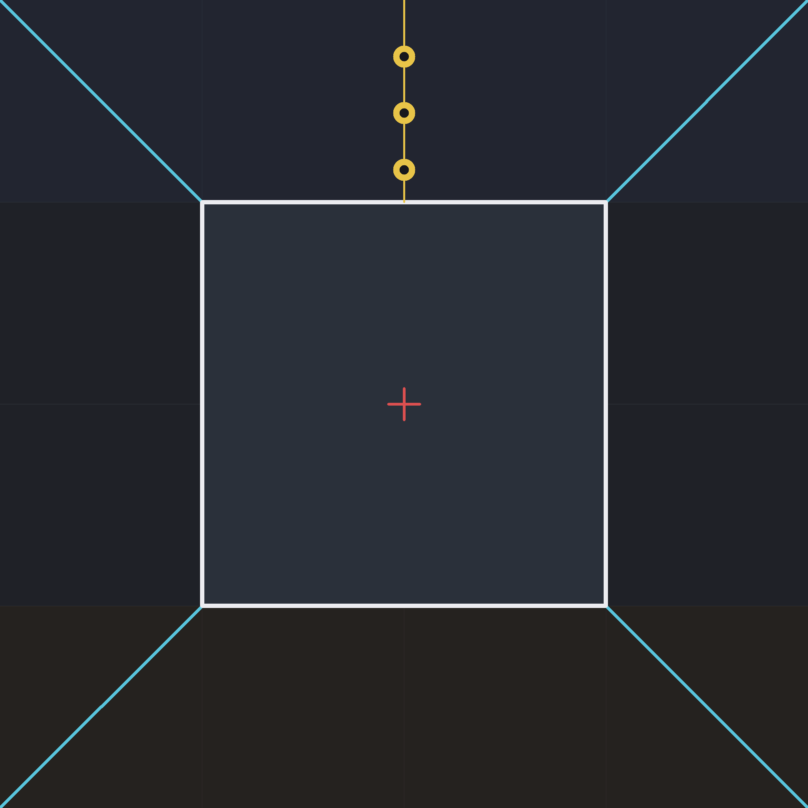

# interior-mapping-webgpu

[English](README.md) · [中文](README.zh-CN.md)

three.js `0.187` WebGPU 场景：带院子的三层小楼（`studio_3f_im.glb`），南、北窗做 2D Interior Mapping。日夜两套光，夜里有路灯、门楣灯和窗灯。后期是泛光、调色、ACES、抖动。楼模、表面纹理和 2D Interior Map 都是 AI 做的。

在线演示：https://interior-mapping-webgpu.vercel.app/  
需要支持 WebGPU 的浏览器（Chrome、Edge 或较新的 Safari）。

## 运行

```bash
pnpm install
pnpm dev
```

打开 http://localhost:5173/

## 操作

拖动、滚轮环视楼。右下角三个图标，从左到右：

- 太阳 / 月亮：白天、夜晚
- 窗格：开关室内映射
- 灯泡：夜里开关窗灯（白天不可用）。路灯和门楣灯只跟日夜走，不跟这颗按钮

## 室内图

出图规范见 [`public/docs/im-2d.md`](public/docs/im-2d.md)。成品要和下面这张模板对齐：白框是远墙，青线是墙角，红十字是灭点。



文件在 `public/textures/im/L{0-2}/`，命名 `{day|night}-{N|S}-L{0-2}-{W|C|E}.png`。南面一层中间是门，没有 `S-L0-C`。
